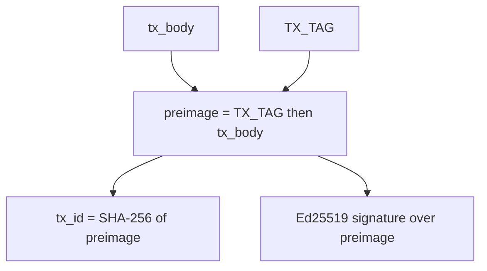
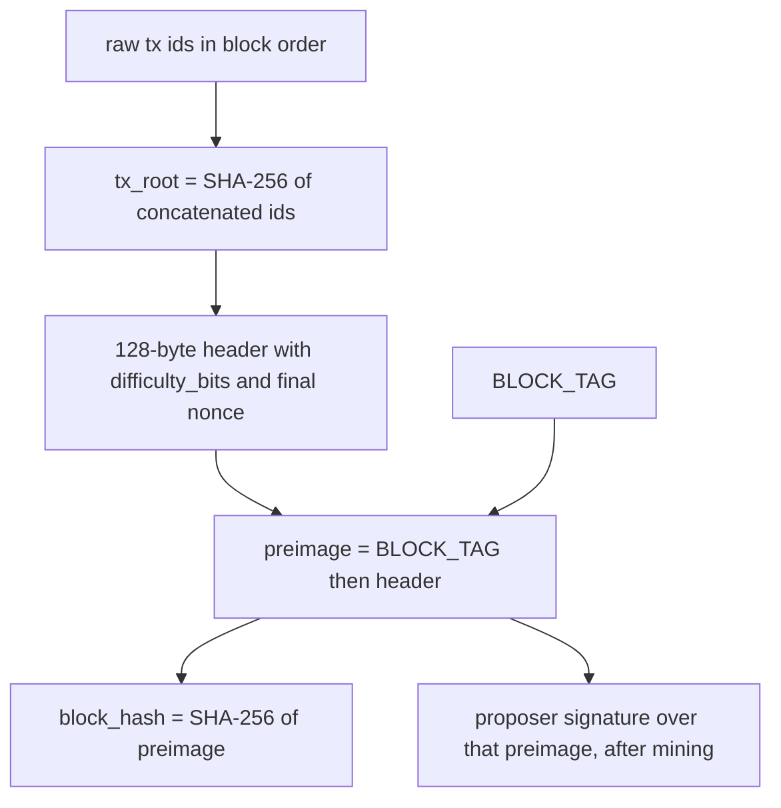

# ADR 0001: Canonical serialisation

- **Status:** Accepted
- **Date:** 2026-10-27
- **Ticket:** [SCRUM-14](https://stevenkeith85.atlassian.net/browse/SCRUM-14)

## Status

Accepted.

## Amendment

Before acceptance, the block header was extended for proof of work. `difficulty_bits` (`u32`) and `nonce` (`u64`) were appended, in that order, after `proposer_public_key`. Version stays `1` and `BLOCK_TAG` stays `LedgerLab/block/v1`, because this layout had not shipped. The block hash is still `SHA-256(BLOCK_TAG || header)` over the full 128-byte header. The proposer signature stays outside that header.

Before acceptance, the coinbase was fixed in this same version. It is one ordinary input whose `prev_tx_id` is 32 zero bytes and whose `output_index` is the block height, and it carries no signature. An `input_count` of 0 is not a coinbase. Two coinbases that pay the same key the same amount at different heights therefore have different transaction ids. A standalone decoder recognises the coinbase by that input shape alone, without a block; position and the height check are block validation.

## Context

LedgerLab is a single-node UTXO chain. A transaction id is the hash of a transaction. A block hash is the hash of a header. Ed25519 signatures cover those same messages. Python on the node, SQL in Postgres, a future React or Angular client, and the CI vectors all have to produce those bytes without consulting each other.

If two encoders disagree by a single byte, the id changes, the signature fails, and a block built by one implementation is invalid to the other. The encoding therefore has to be a function: one logical transaction, one byte string. It also has to be small enough to reimplement from this document with `int.to_bytes` and SHA-256, because the check that matters is an independent implementation, not a second call into the node.

[SCRUM-15](https://stevenkeith85.atlassian.net/browse/SCRUM-15) implements transactions against this ADR. [SCRUM-17](https://stevenkeith85.atlassian.net/browse/SCRUM-17) turns the vectors into a CI test. Amounts carried in the body are the integers defined by [ADR 0002](0002-integer-amounts.md).

Primitives already chosen, and not reopened here: SHA-256 (32-byte digest) and Ed25519 as specified by RFC 8032.

## Options considered

### JSON, including RFC 8785 (JCS)

Advantages: readable in logs; libraries exist in every language the client and the node use; fine as a debugging view.

Costs: object key order, insignificant whitespace, Unicode escaping, duplicate keys, and number spelling (`1`, `1.0`, `1e0`, `1.00`) each change the bytes. RFC 8785 closes some of this and still leaves an encoder that is easy to get almost right. The amount domain would be a JSON number unless every encoder were forced onto a non-standard spelling, which fights ADR 0002. Rejected as the bytes that are hashed or signed. A JSON API may exist beside the canonical bytes; it is not those bytes.

### Deterministic CBOR (RFC 8949)

Advantages: binary, typed, and a published deterministic profile; smaller than JSON; maps and arrays match transaction structure.

Costs: preferred serialization is a profile on top of a format that also allows indefinite lengths, different integer widths, and more than one key order. A decoder that accepts any legal CBOR will accept non-canonical input and break `encode(decode(b)) == b`. Reviewing a dispute means reading the CBOR rules, not a table. Rejected.

### Protocol Buffers or a similar schema compiler

Advantages: an explicit schema; generated parsers; familiar field evolution.

Costs: proto3 omits default values, field order on the wire is not fixed, and unknown fields round-trip only in some runtimes. Two encodings of one message are normal. That breaks a content-addressed id. Rejected.

### Bitcoin-style serialisation (compact sizes, scripts)

Advantages: well known to blockchain engineers; variable-length integers save bytes on small counts.

Costs: compact-size integers have non-minimal forms that every decoder must remember to reject. Script bytes inside the hashed message are the historical source of transaction-id malleability. LedgerLab has no script language. The useful lesson is kept: signatures stay out of the hashed bytes, and non-minimal input is rejected. The encoding itself is rejected.

### Fixed custom binary (chosen)

Advantages: one legal byte string per value. Widths are fixed, so there is no shorter integer encoding to police. Field order is a table. Big-endian matches the usual network order and is unambiguous. A second language can implement it without a codegen step or a parser generator. Domain-separation tags stop a transaction signature from verifying as a block signature.

Costs: the bytes are not self-describing. This ADR is the schema. New fields need a new version and a new tag, not a free-form extension. Humans inspect hex, or the vector file, rather than pretty-printed JSON.

## Decision

Canonical encoding is this custom binary layout. Integers are unsigned and big-endian. There is no variable-width integer, no length prefix in front of a fixed-width field, and no optional field. Counts below are counts of elements, not counts of bytes.

### Domain-separation tags

| Name | ASCII | Following byte | Hex |
| --- | --- | --- | --- |
| `TX_TAG` | `LedgerLab/tx/v1` | `0x00` | `4c65646765724c61622f74782f763100` |
| `BLOCK_TAG` | `LedgerLab/block/v1` | `0x00` | `4c65646765724c61622f626c6f636b2f763100` |

The `0x00` byte is part of the tag. It is not a C string terminator that an encoder may drop. The tags are 16 and 19 bytes.

### Transaction body

The body is the unsigned transaction. Bytes in this order:

| Order | Field | Width | Rule |
| --- | --- | --- | --- |
| 1 | `version` | `u32` | Must be `1`. |
| 2 | `input_count` | `u32` | `1..=1000`. Check the bound before reading the inputs. |
| 3 | `inputs` | `input_count` times one input | Each input is the next row. |
| 4 | `output_count` | `u32` | `1..=1000`. Check the bound before reading the outputs. |
| 5 | `outputs` | `output_count` times one output | Each output is the last row. |

Each input, in order:

| Order | Field | Width | Rule |
| --- | --- | --- | --- |
| 1 | `prev_tx_id` | 32 raw bytes | The referenced transaction id. Not hex text. |
| 2 | `output_index` | `u32` | Index of the output inside that transaction. In a coinbase, this field is the block height. |

Each output, in order:

| Order | Field | Width | Rule |
| --- | --- | --- | --- |
| 1 | `amount` | `u64` | Integer from ADR 0002. Encoded even though the legal maximum is below `2**64 - 1`. |
| 2 | `recipient_public_key` | 32 raw bytes | Ed25519 public key. Not SPKI, PEM, or hex. |

Body length is `12 + 36 * input_count + 40 * output_count` bytes. Offsets inside a body:

- `version` at `0`
- `input_count` at `4`
- first input at `8`; input `i` is 36 bytes at `8 + 36 * i`
- `output_count` at `8 + 36 * input_count`
- first output at `12 + 36 * input_count`; output `j` is 40 bytes

`input_count` of `0` is not a legal body. `output_count` of `0` is not a legal body.

### Two transaction preimages

Both preimages are named here. They are the same byte string.

| Preimage | Bytes | What consumes it |
| --- | --- | --- |
| Signing preimage | `TX_TAG` concatenated with `tx_body` | Ed25519, once per non-coinbase input. A coinbase has no signature. |
| Transaction-id preimage | `TX_TAG` concatenated with `tx_body` | SHA-256, producing the 32-byte transaction id |

`tx_id = SHA-256(TX_TAG || tx_body)`.

Every non-coinbase input signs that same preimage. The scheme is sighash-all: one signature authorises the whole body, including the other inputs and every output. There is no other sighash mode. A coinbase has a signature count of 0.

Signatures are not part of the body and not part of either preimage. Each non-coinbase signature is the 64-byte RFC 8032 Ed25519 signature of the signing preimage, under the private key that can spend that input. The list is in input order. Because the id hashes the body and the tag only, replacing a signature does not change the id. A transaction id must be unique across the chain.

Verification uses RFC 8032, which rejects a non-canonical `S`. The 64-byte value in the vector file is the only signature that verifies for that key and preimage.

When a complete transaction is one byte string, the envelope is the body followed by the raw signatures in input order, 64 bytes each. A standalone decoder chooses that signature count from the body shape, with no block in hand. A coinbase — exactly one input whose `prev_tx_id` is 32 zero bytes — has no signatures, so its envelope is the body alone. Every other body has one 64-byte signature per input. Trailing bytes after the envelope are rejected. Postgres columns and JSON hex fields may store the body and the signature list separately; whichever container is used, the signature bytes stay raw, stay in input order, and stay out of both preimages. A coinbase signature list is empty.

### Coinbase

A coinbase is an ordinary transaction body with one defined input. The layout does not gain a coinbase-only field.

A standalone decoder has no block context. It classifies a transaction as a coinbase by shape alone: exactly one input whose `prev_tx_id` is 32 zero bytes. Any other input list is a non-coinbase. The classification does not use `output_index`, and it does not use the transaction's position in a block.

Such a transaction has no signatures in its envelope. The envelope is the body alone. Signature bytes after that body are trailing bytes, and the decoder rejects them. `spend_zero_prev_tx_id` is this case: the body is a shape-coinbase, so the check that fires is the trailing-byte rejection on the envelope. The non-coinbase rule against an all-zero `prev_tx_id` does not apply to it.

| Field | Value |
| --- | --- |
| `input_count` | `1` |
| `prev_tx_id` | 32 bytes of `0x00` |
| `output_index` | the block height, as a `u32`, checked when the transaction is placed in a block |
| signature count | `0` |

Outputs are ordinary outputs and follow ADR 0002. The vectors use one output of the fixture amount `50000000` paid to one key. That amount is not a protocol reward and it is not a supply cap. `output_count` remains `1..=1000`.

Block validation then adds the positional rules. The standalone decoder does not apply them.

- The first transaction of every block is a coinbase. Only that transaction may be a coinbase. A shape-coinbase outside position 0 is rejected at block validation.
- The coinbase `output_index` must equal the block's `height`.
- `height` must fit in a `u32`. A block whose `height` is greater than `2**32 - 1` (`4294967295`) is rejected, because the coinbase input cannot store it. Heights above that are out of scope for this toy chain. The header field stays a `u64`.
- A non-coinbase transaction has `input_count` in `1..=1000` and one signature per input. None of its inputs may use the all-zero `prev_tx_id`. A list of two or more inputs that contains that id is a non-coinbase and fails this rule. A single all-zero input is a coinbase, not this case.
- A transaction id must be unique across the chain. Putting the height in the coinbase input is what makes a fixed reward to the same key differ from block to block.

### Block header

The header is 128 bytes, in this order:

| Offset | Field | Width | Rule |
| --- | --- | --- | --- |
| 0 | `version` | `u32` | Must be `1`. |
| 4 | `height` | `u64` | Block height. |
| 12 | `prev_block_hash` | 32 raw bytes | All `0x00` for the genesis block. |
| 44 | `tx_root` | 32 raw bytes | Defined below. |
| 76 | `timestamp_ms` | `u64` | Unix time in milliseconds, UTC. |
| 84 | `proposer_public_key` | 32 raw bytes | Ed25519 public key of the proposer. |
| 116 | `difficulty_bits` | `u32` | Unsigned big-endian. Legal values are `0` through `255` inclusive. |
| 120 | `nonce` | `u64` | Unsigned big-endian. Mining writes the final value here, before the header is hashed or signed. |

`tx_root = SHA-256(tx_id_0 || tx_id_1 || ... || tx_id_n-1)`, the concatenation of the raw 32-byte transaction ids in block order. The hash input is those raw digests, not their hex encoding. The first id is the coinbase. Zero transactions would hash the empty string, and that block is rejected because it has no coinbase.

This is a single hash of the concatenated ids, not a Merkle tree. A Merkle tree is the upgrade path when a light client needs inclusion proofs. It is not the commitment today.

`difficulty_bits` is a chain-level consensus parameter fixed in the genesis block. A node rejects any block whose `difficulty_bits` is not that genesis value. A test chain uses its own genesis and may set a low difficulty. The vectors use `16` as that test-chain genesis value.

The proof-of-work predicate is part of this encoding so every implementation compares the same integers. Read `block_hash` as a big-endian unsigned 256-bit integer `H`. The header meets the target only when `H < 2**(256 - difficulty_bits)`. [ADR 0003](0003-consensus-proof-of-work.md) holds the consensus rationale for proof of work. It does not replace this comparison.

The inequality is the rule. It accepts every hash with at least `difficulty_bits` leading zero bits, and no hash with fewer. In particular, a hash with exactly `difficulty_bits` leading zero bits passes, because then `2**(256 - difficulty_bits - 1) <= H < 2**(256 - difficulty_bits)`. When `difficulty_bits` is at least 1, a hash with exactly one fewer leading zero bit fails, because then `H >= 2**(256 - difficulty_bits)`. A hash with more than `difficulty_bits` leading zero bits also passes. `difficulty_bits` of `256` or more is not a legal field value, so there is no target of `2**0` from an out-of-range difficulty.

### Block preimage

The block has one preimage. The hash and the proposer signature both use it, and the signature is made only after mining.

| Role | Bytes |
| --- | --- |
| Block-hash preimage | `BLOCK_TAG` concatenated with the 128-byte header |
| Proposer signing preimage | those same bytes, including the final nonce |

`block_hash = SHA-256(BLOCK_TAG || header)`.

The proposer signs the header bytes, not the digest. The signed message is `BLOCK_TAG` concatenated with the 128-byte header, and that header already contains `difficulty_bits` and the nonce mining selected. The signature is not `SHA-256(BLOCK_TAG || header)`; that 32-byte value is the block hash. Mining finishes first. A signature over any earlier nonce does not verify for the finished header. The signature is 64 raw Ed25519 bytes carried beside the header. It stays outside the hashed header, so it is not an input to `block_hash`.

A signed header as one byte string is the 128-byte header followed by the 64-byte proposer signature (192 bytes). A shorter string is truncated. Trailing bytes are rejected. The full transaction list is not appended to that string. The header commits to the ordered ids through `tx_root`, and each id commits to its body. Nodes still verify every transaction signature; the block hash is not a substitute for that check.

### How the id and the signature are derived

The signature and the transaction id are siblings. The signature is not hashed into the id. The same shape, with `BLOCK_TAG` and the header, produces the block hash and the proposer signature:

### Decoding

A decoder accepts a byte string only when it is exactly the encoding this ADR defines.

- Reject a truncated string: not enough bytes for the counts and the fixed widths. A block header shorter than 128 bytes is truncated. A 116-byte header is not valid version 1.
- Reject trailing bytes after the body, after the transaction envelope, after the 128-byte header, or after the signed header (the header plus the 64-byte proposer signature), whichever string is being decoded.
- Reject `version` other than `1`.
- Reject `difficulty_bits` outside `0..=255`. The field is a `u32`, so `256` and any larger integer fit in the field and are still rejected.
- Reject a block whose `difficulty_bits` differs from the genesis block of that chain. Test chains set the value in their own genesis.
- Reject a decoded header whose block hash, as a big-endian unsigned 256-bit integer, is not strictly less than `2**(256 - difficulty_bits)`. The header can be the right width and still fail this check.
- Reject `input_count` outside `1..=1000`, and `output_count` outside `1..=1000`, before allocating or reading that many items. `input_count` of 0 is rejected.
- With no block in hand, classify by shape. Exactly one input whose `prev_tx_id` is 32 zero bytes is a coinbase, and its envelope has no signatures. Every other body has one signature per input. Signature bytes after a coinbase body are trailing bytes.
- Reject, at block validation, a block whose first transaction is not a coinbase, a shape-coinbase outside position 0, or a coinbase whose `output_index` is not the block height. The standalone decoder does not apply these positional rules.
- Reject a block whose `height` is greater than `2**32 - 1`.
- Reject a non-coinbase transaction that references the all-zero `prev_tx_id`. A body with exactly one such input is a coinbase, so this rule does not apply to it; an extra signature on that body is the trailing-byte rejection above.
- Reject anything that is not the single fixed-width form: no compact-size integers, no DER or PEM wrapping of keys or signatures, no hex inside the hashed bytes.
- `encode(decode(b)) == b` for a transaction body, a transaction envelope, a block header, and a signed header.

Amount range and sums are ADR 0002. A structural decode may return a `u64` that validation then rejects. A transaction is not accepted, stored, or relayed until both layers succeed.

### Versioning

The version field is inside the hashed and signed body and header, so a body with a different version is a different id and a different signature. The tag sits outside the body and separates this protocol from another message that might share a prefix. A new layout bumps both: `version` becomes `2` and the tag becomes a new string (for example `LedgerLab/tx/v2` plus `0x00`). Shipping a new version under the old tag, or the old version under a new tag, is not a supported migration. Decoders written for v1 reject every other version. The proof-of-work fields are already part of version 1; they were added before this ADR was accepted, so they are not a version bump.

## Consequences

- **Determinism.** One logical body has one byte string. RFC 8032 signing adds no signature nonce, so an Ed25519 signature in the vectors is a fixed value a second implementation must reproduce. The block `nonce` is the proof-of-work field, not a signature nonce.
- **Auditability.** Anyone with the body can recompute the transaction id, and anyone with the header can recompute the block hash, without holding a private key and without trusting the node that stored the row.
- **Cross-language reproducibility.** Fixed widths, unsigned big-endian, raw keys, and SHA-256 are the whole codec. No locale, no map sort, no JSON number parser on the hashed path.
- **Versioning.** The version field and the domain tag are the only extension mechanism. Old signatures do not verify under a new tag.
- **Malleability.** The transaction id does not cover signatures, so a different signature byte string is a different envelope and the same id. Ed25519's deterministic, canonical signature removes the usual second-signature trick; excluding the signature from the hash keeps the id stable even if a verifier is wrong about canonical `S`.
- **Sighash.** Every non-coinbase input signs the entire body. A signer cannot authorise one output and leave the rest open. Adding a sighash mode is a new version and a new tag. A coinbase has no signature.
- **Allocation.** The count limits are part of decoding. A million-input message fails the `u32` bound check instead of allocating.
- **Commitment shape.** `tx_root` is a hash of concatenated ids. Light-client inclusion proofs need a Merkle tree later. Until that ADR, clients that want inclusion rehash the full id list.
- **What the block hash covers.** It covers the 128-byte header, including `difficulty_bits` and `nonce`, and nothing after it. Transaction signatures and the proposer signature are checked as signatures. The proposer signature is computed from the finished preimage, so it commits to the mined nonce without changing the hash. Storage that rewrites a signature still has to pass verification on read.

### Test vectors

[vectors/serialisation.json](vectors/serialisation.json) is generated by [vectors/generate.py](vectors/generate.py). Do not hand-edit the JSON. The script's docstring has the run command. It depends on the standard library and `cryptography`, uses `Ed25519PrivateKey.from_private_bytes`, and writes sorted keys, a two-space indent, and a trailing newline.

The file is the oracle for SCRUM-15 and for the SCRUM-17 CI test. It contains:

| Vector | What it pins |
| --- | --- |
| `sample` | One input, one output, amount `1000`, signed by test key A. |
| `normal` | Two inputs and two outputs. Key A signs input 0, key B signs input 1. The second `output_index` is `65539` (`00 01 00 03`) and the second amount is `4294967297` (`00 00 00 01 00 00 00 01`). |
| `min_amount` | One output of amount `1`, the eight bytes `00 00 00 00 00 00 00 01`. |
| `max_amount` | One output of amount `9007199254740991`, the eight bytes `00 1f ff ff ff ff ff ff`. |
| `coinbase_height_1` | Coinbase at height 1. One input, `prev_tx_id` thirty-two `0x00` bytes, `output_index` `1`, no signature. One output of `50000000` to test key A. Id `49037913630a8a18719c8299f02133fea2835dcb90b52bdea250c27f11de8b8c`. |
| `coinbase_height_2` | Same key and amount at height 2. Id `34f7b61c92bf43f5ef1c542a79409063241758ef38288d332dd83f615ebd83fb`. |
| `coinbase_height_42` | Same key and amount at height 42, the coinbase inside the mined block. Id `c8b76f181fc8fac43deff12b0d9f2b221dbaa670d69612313d92644af4dfc061`. |
| `spend_zero_prev_tx_id` | Shape-coinbase: one input whose `prev_tx_id` is thirty-two `0x00` bytes, with a signature appended. The standalone envelope decoder rejects those extra bytes as trailing. Block position is not part of this check. |
| `amount_zero` | Invalid. One signed output of amount `0`. The signature verifies; the amount is below 1. See ADR 0002. |
| `amount_over_max` | Invalid. One signed output of amount `9007199254740992` (`2**53`). It fits in a `u64` and is above `MAX_AMOUNT`. The signature verifies. See ADR 0002. |
| `tampered_body` | Invalid. Signed as a normal one-input transaction, then the last body byte was XORed with `0x01`. `signatures_hex` does not verify over `signing_preimage_hex`. |
| `block` | 128-byte header. First transaction is `coinbase_height_42`, then `sample`, `normal`, `min_amount`, `max_amount`. Height `42`, `timestamp_ms` `1735689600000` (`2025-01-01T00:00:00.000Z`), `prev_block_hash` thirty-two `0x00` bytes, proposer test key A, `difficulty_bits` `16`. Nonce `6617` is the smallest from 0 whose hash is under the target (18 leading zero bits). Hash `000038aa8c7b27aaf63b436cc6770e589f8c720f643499a3e2a7442da43f5dcc`. |
| `block_boundary_pass` | Same header fields and transaction ids, nonce `10657`. The hash has exactly 16 leading zero bits and passes. Hash `0000cf60acd4bc42024a6e73320157418c96ce6e4bd97f1c5d6a0d4f04fe6d8e`. |
| `block_boundary_fail` | Same header fields and transaction ids, nonce `39612`. The hash has exactly 15 leading zero bits and fails the target. The proposer signature on this header is still valid. Hash `0001b21d3de8604e314ee3b689b783c4cd87cc8d749d76f3fc2a96f6098b51a2`. |
| `block_coinbase_height_mismatch` | Header height `42`, but the first transaction is `coinbase_height_1` (`output_index` `1`). Nonce `162336` meets difficulty 16. The block is still invalid. Hash `00005b98e58590f7a5ff1c6c18ba307eae942f0679ba7221322fc164e4277384`. |

On each transaction, `fields` holds the logical values (`prev_tx_id` and public keys as lowercase hex, counts and amounts as JSON integers). `body_hex` is the body. `signing_preimage_hex` and `tx_id_preimage_hex` are both `TX_TAG || tx_body`; they are equal, and the names exist so a test can tell the two roles apart. `tx_id_hex` is SHA-256 of that preimage. For a non-coinbase, `signatures_hex[i]` matches `signing_keys[i]` and `fields.inputs[i]`. A coinbase has both lists empty. Seeds and public keys are hex, next to the warning `TEST ONLY - never use these keys for real value`, on the top-level `keys` array and on every signing key that exists. Test key A has seed `00 01 … 1f`. Test key B has seed `20 21 … 3f`.

On each block vector, `fields` is the header, including `difficulty_bits` and `nonce`. `header_hex` is those 128 bytes. `preimage_hex` is `BLOCK_TAG || header` with that final nonce. `block_hash_hex` is SHA-256 of the preimage. `proposer_signature_hex` is the Ed25519 signature of that same preimage, produced after the nonce was chosen, and it does not verify over the bare hash or over a header with a different nonce. `leading_zero_bits` and `meets_pow_target` record the boundary check. `tx_ids_hex` is the raw ids that were concatenated, in order.

`constants` in the same file repeats the tag hex, the field order, the widths' names, the count limits, and both preimage formulas so a test can load them without parsing this document. If `constants` and this ADR ever disagree, this ADR wins and the generator is fixed.

The previous-transaction ids inside the vectors are synthetic 32-byte patterns. They are not the ids of the other vectors, and they do not imply that those outpoints exist.

### Open points

- **Block height.** Heights above `2**32 - 1` are rejected. They are out of scope for this toy chain.
- **Proof of work rationale.** The target comparison, the `0..=255` range, and the rule that `difficulty_bits` is fixed in genesis are stated above. Why the chain uses proof of work is [ADR 0003](0003-consensus-proof-of-work.md).
- **`AGENTS.md`.** [SCRUM-13](https://stevenkeith85.atlassian.net/browse/SCRUM-13) is adding `AGENTS.md`. That guide will link to this ADR and will not copy the layout. This change does not edit `AGENTS.md`.
