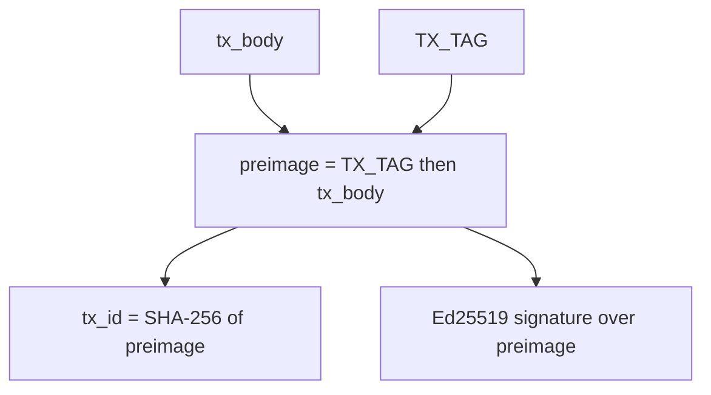
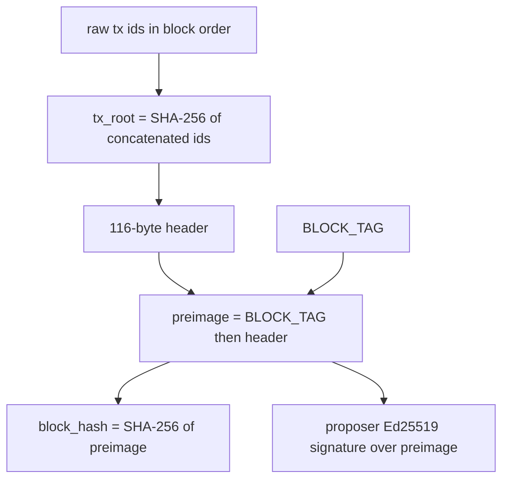

# ADR 0001: Canonical serialisation

- **Status:** Accepted
- **Date:** 2026-10-27
- **Ticket:** [SCRUM-14](https://stevenkeith85.atlassian.net/browse/SCRUM-14)

## Status

Accepted.

## Context

LedgerLab is a single-node UTXO chain. A transaction id is the hash of a transaction. A block hash is the hash of a header. Ed25519 signatures cover those same messages. Python on the node, SQL in Postgres, a future React or Angular client, and the CI vectors all have to produce those bytes without consulting each other.

If two encoders disagree by a single byte, the id changes, the signature fails, and a block built by one implementation is invalid to the other. The encoding therefore has to be a function: one logical transaction, one byte string. It also has to be small enough to reimplement from this document with `int.to_bytes` and SHA-256, because the check that matters is an independent implementation, not a second call into the node.

[SCRUM-15](https://stevenkeith85.atlassian.net/browse/SCRUM-15) implements transactions against this ADR. [SCRUM-16](https://stevenkeith85.atlassian.net/browse/SCRUM-16) implements blocks. [SCRUM-17](https://stevenkeith85.atlassian.net/browse/SCRUM-17) turns the vectors into a CI test. Amounts carried in the body are the integers defined by [ADR 0002](0002-integer-amounts.md).

Primitives already chosen, and not reopened here: SHA-256 (32-byte digest) and Ed25519 as specified by RFC 8032.

## Options considered

### JSON, including RFC 8785 (JCS)

Advantages: readable in logs; libraries exist in every language the client and the node use; fine as a debugging view.

Costs: object key order, insignificant whitespace, Unicode escaping, duplicate keys, and number spelling (`1`, `1.0`, `1e0`, `1.00`) each change the bytes. RFC 8785 closes some of this and still leaves an encoder that is easy to get almost right. The amount domain would be a JSON number unless every encoder were forced onto a non-standard spelling, which fights ADR 0002. Rejected as the bytes that are hashed or signed. A JSON API may exist beside the canonical bytes; it is not those bytes.

### Deterministic CBOR (RFC 8949)

Advantages: binary, typed, and a published deterministic profile; smaller than JSON; maps and arrays match transaction structure.

Costs: preferred serialization is a profile on top of a format that also allows indefinite lengths, different integer widths, and more than one key order. A decoder that accepts any legal CBOR will accept non-canonical input and break `encode(decode(b)) == b`. Reviewing a dispute means reading the CBOR rules, not a table. Rejected.

### Protocol Buffers or a similar schema compiler

Advantages: an explicit schema; generated parsers; familiar field evolution.

Costs: proto3 omits default values, field order on the wire is not fixed, and unknown fields round-trip only in some runtimes. Two encodings of one message are normal. That breaks a content-addressed id. Rejected.

### Bitcoin-style serialisation (compact sizes, scripts)

Advantages: well known to blockchain engineers; variable-length integers save bytes on small counts.

Costs: compact-size integers have non-minimal forms that every decoder must remember to reject. Script bytes inside the hashed message are the historical source of transaction-id malleability. LedgerLab has no script language. The useful lesson is kept: signatures stay out of the hashed bytes, and non-minimal input is rejected. The encoding itself is rejected.

### Fixed custom binary (chosen)

Advantages: one legal byte string per value. Widths are fixed, so there is no shorter integer encoding to police. Field order is a table. Big-endian matches the usual network order and is unambiguous. A second language can implement it without a codegen step or a parser generator. Domain-separation tags stop a transaction signature from verifying as a block signature.

Costs: the bytes are not self-describing. This ADR is the schema. New fields need a new version and a new tag, not a free-form extension. Humans inspect hex, or the vector file, rather than pretty-printed JSON.

## Decision

Canonical encoding is this custom binary layout. Integers are unsigned and big-endian. There is no variable-width integer, no length prefix in front of a fixed-width field, and no optional field. Counts below are counts of elements, not counts of bytes.

### Domain-separation tags

| Name | ASCII | Following byte | Hex |
| --- | --- | --- | --- |
| `TX_TAG` | `LedgerLab/tx/v1` | `0x00` | `4c65646765724c61622f74782f763100` |
| `BLOCK_TAG` | `LedgerLab/block/v1` | `0x00` | `4c65646765724c61622f626c6f636b2f763100` |

The `0x00` byte is part of the tag. It is not a C string terminator that an encoder may drop. The tags are 16 and 19 bytes.

### Transaction body

The body is the unsigned transaction. Bytes in this order:

| Order | Field | Width | Rule |
| --- | --- | --- | --- |
| 1 | `version` | `u32` | Must be `1`. |
| 2 | `input_count` | `u32` | `0..=1000`. Check the bound before reading the inputs. |
| 3 | `inputs` | `input_count` times one input | Each input is the next row. |
| 4 | `output_count` | `u32` | `1..=1000`. Check the bound before reading the outputs. |
| 5 | `outputs` | `output_count` times one output | Each output is the last row. |

Each input, in order:

| Order | Field | Width | Rule |
| --- | --- | --- | --- |
| 1 | `prev_tx_id` | 32 raw bytes | The referenced transaction id. Not hex text. |
| 2 | `output_index` | `u32` | Index of the output inside that transaction. |

Each output, in order:

| Order | Field | Width | Rule |
| --- | --- | --- | --- |
| 1 | `amount` | `u64` | Integer from ADR 0002. Encoded even though the legal maximum is below `2**64 - 1`. |
| 2 | `recipient_public_key` | 32 raw bytes | Ed25519 public key. Not SPKI, PEM, or hex. |

Body length is `12 + 36 * input_count + 40 * output_count` bytes. Offsets inside a body:

- `version` at `0`
- `input_count` at `4`
- first input at `8`; input `i` is 36 bytes at `8 + 36 * i`
- `output_count` at `8 + 36 * input_count`
- first output at `12 + 36 * input_count`; output `j` is 40 bytes

`input_count` of `0` encodes no input bytes and then the output list. The consensus meaning of that shape is an open point (below). `output_count` of `0` is not a legal body.

### Two transaction preimages

Both preimages are named here. They are the same byte string.

| Preimage | Bytes | What consumes it |
| --- | --- | --- |
| Signing preimage | `TX_TAG` concatenated with `tx_body` | Ed25519, once per input |
| Transaction-id preimage | `TX_TAG` concatenated with `tx_body` | SHA-256, producing the 32-byte transaction id |

`tx_id = SHA-256(TX_TAG || tx_body)`.

Every input signs that same preimage. The scheme is sighash-all: one signature authorises the whole body, including the other inputs and every output. There is no other sighash mode.

Signatures are not part of the body and not part of either preimage. Each signature is the 64-byte RFC 8032 Ed25519 signature of the signing preimage, under the private key that can spend that input. The list is in input order. Because the id hashes the body and the tag only, replacing a signature does not change the id.

Verification uses RFC 8032, which rejects a non-canonical `S`. The 64-byte value in the vector file is the only signature that verifies for that key and preimage.

When a complete transaction is one byte string, the envelope is the body followed by the raw signatures in input order, 64 bytes each. A zero-input body has an empty signature list, so the envelope equals the body. Trailing bytes after the envelope are rejected. Postgres columns and JSON hex fields may store the body and the signature list separately; whichever container is used, the signature bytes stay raw, stay in input order, and stay out of both preimages.

### Block header

The header is 116 bytes, in this order:

| Offset | Field | Width | Rule |
| --- | --- | --- | --- |
| 0 | `version` | `u32` | Must be `1`. |
| 4 | `height` | `u64` | Block height. |
| 12 | `prev_block_hash` | 32 raw bytes | All `0x00` for the genesis block. |
| 44 | `tx_root` | 32 raw bytes | Defined below. |
| 76 | `timestamp_ms` | `u64` | Unix time in milliseconds, UTC. |
| 84 | `proposer_public_key` | 32 raw bytes | Ed25519 public key of the proposer. |

`tx_root = SHA-256(tx_id_0 || tx_id_1 || ... || tx_id_n-1)`, the concatenation of the raw 32-byte transaction ids in block order. The hash input is those raw digests, not their hex encoding. Zero transactions produce `SHA-256` of the empty string. Whether a block with zero transactions is valid is a consensus question for SCRUM-16; the hash of the empty concatenation is the encoding either way.

This is a single hash of the concatenated ids, not a Merkle tree. A Merkle tree is the upgrade path when a light client needs inclusion proofs. It is not the commitment today.

### Block preimage

The block has one preimage, used twice:

| Role | Bytes |
| --- | --- |
| Block-hash preimage | `BLOCK_TAG` concatenated with the header |
| Proposer signing preimage | `BLOCK_TAG` concatenated with the header |

`block_hash = SHA-256(BLOCK_TAG || header)`.

The proposer's Ed25519 signature over that preimage is 64 bytes, carried with the block, and is not an input to the block hash. Who may propose, and the round-robin schedule, are [SCRUM-19](https://stevenkeith85.atlassian.net/browse/SCRUM-19). This ADR only fixes the signed bytes and the hash.

A signed header as one byte string is the 116-byte header followed by the 64-byte proposer signature. Trailing bytes are rejected. The full transaction list is not appended to that string. The header commits to the ordered ids through `tx_root`, and each id commits to its body. Nodes still verify every transaction signature; the block hash is not a substitute for that check.

### How the id and the signature are derived

The signature and the transaction id are siblings. The signature is not hashed into the id. The same shape, with `BLOCK_TAG` and the header, produces the block hash and the proposer signature:

### Decoding

A decoder accepts a byte string only when it is exactly the encoding this ADR defines.

- Reject a truncated string: not enough bytes for the counts and the fixed widths.
- Reject trailing bytes after the body, after the transaction envelope, after the header, or after the signed header, whichever string is being decoded.
- Reject `version` other than `1`.
- Reject `input_count` outside `0..=1000`, and `output_count` outside `1..=1000`, before allocating or reading that many items.
- Reject anything that is not the single fixed-width form: no compact-size integers, no DER or PEM wrapping of keys or signatures, no hex inside the hashed bytes.
- `encode(decode(b)) == b` for a transaction body, a transaction envelope, a block header, and a signed header.

Amount range and sums are ADR 0002. A structural decode may return a `u64` that validation then rejects. A transaction is not accepted, stored, or relayed until both layers succeed.

### Versioning

The version field is inside the hashed and signed body and header, so a body with a different version is a different id and a different signature. The tag sits outside the body and separates this protocol from another message that might share a prefix. A new layout bumps both: `version` becomes `2` and the tag becomes a new string (for example `LedgerLab/tx/v2` plus `0x00`). Shipping a new version under the old tag, or the old version under a new tag, is not a supported migration. Decoders written for v1 reject every other version.

## Consequences

- **Determinism.** One logical body has one byte string. RFC 8032 signing adds no nonce, so the signature in the vectors is a fixed value a second implementation must reproduce.
- **Auditability.** Anyone with the body can recompute the transaction id, and anyone with the header can recompute the block hash, without holding a private key and without trusting the node that stored the row.
- **Cross-language reproducibility.** Fixed widths, unsigned big-endian, raw keys, and SHA-256 are the whole codec. No locale, no map sort, no JSON number parser on the hashed path.
- **Versioning.** The version field and the domain tag are the only extension mechanism. Old signatures do not verify under a new tag.
- **Malleability.** The transaction id does not cover signatures, so a different signature byte string is a different envelope and the same id. Ed25519's deterministic, canonical signature removes the usual second-signature trick; excluding the signature from the hash keeps the id stable even if a verifier is wrong about canonical `S`.
- **Sighash.** Every input signs the entire body. A signer cannot authorise one output and leave the rest open. Adding a sighash mode is a new version and a new tag.
- **Allocation.** The count limits are part of decoding. A million-input message fails the `u32` bound check instead of allocating.
- **Commitment shape.** `tx_root` is a hash of concatenated ids. Light-client inclusion proofs need a Merkle tree later. Until that ADR, clients that want inclusion rehash the full id list.
- **What the block hash does not cover.** It covers the header. Transaction signatures and the proposer signature are checked as signatures, not by comparing the block hash. Storage that rewrites a signature still has to pass verification on read.

### Test vectors

[vectors/serialisation.json](vectors/serialisation.json) is generated by [vectors/generate.py](vectors/generate.py). Do not hand-edit the JSON. The script's docstring has the run command. It depends on the standard library and `cryptography`, uses `Ed25519PrivateKey.from_private_bytes`, and writes sorted keys, a two-space indent, and a trailing newline.

The file is the oracle for SCRUM-15 and for the SCRUM-17 CI test. It contains:

| Vector | What it pins |
| --- | --- |
| `sample` | One input, one output, amount `1000`, signed by test key A. |
| `normal` | Two inputs and two outputs. Key A signs input 0, key B signs input 1. The second `output_index` is `65539` (`00 01 00 03`) and the second amount is `4294967297` (`00 00 00 01 00 00 00 01`). |
| `min_amount` | One output of amount `1`, the eight bytes `00 00 00 00 00 00 00 01`. |
| `max_amount` | One output of amount `9007199254740991`, the eight bytes `00 1f ff ff ff ff ff ff`. |
| `block` | The 116-byte header over those four ids, in that order. Height `42`, `timestamp_ms` `1735689600000` (`2025-01-01T00:00:00.000Z`), `prev_block_hash` thirty-two `0x00` bytes, proposer test key A. |

On each transaction, `fields` holds the logical values (`prev_tx_id` and public keys as lowercase hex, counts and amounts as JSON integers). `body_hex` is the body. `signing_preimage_hex` and `tx_id_preimage_hex` are both `TX_TAG || tx_body`; they are equal, and the names exist so a test can tell the two roles apart. `tx_id_hex` is SHA-256 of that preimage. `signatures_hex[i]` matches `signing_keys[i]` and `fields.inputs[i]`. Seeds and public keys are hex, next to the warning `TEST ONLY - never use these keys for real value`, on the top-level `keys` array and on every signing key. Test key A has seed `00 01 … 1f`. Test key B has seed `20 21 … 3f`.

On the block, `fields` is the header, `header_hex` its bytes, `preimage_hex` the block-hash preimage and the proposer signing preimage, `block_hash_hex` the hash, and `proposer_signature_hex` the Ed25519 signature. `tx_ids_hex` is the raw ids that were concatenated, in order.

`constants` in the same file repeats the tag hex, the field order, the widths' names, the count limits, and both preimage formulas so a test can load them without parsing this document. If `constants` and this ADR ever disagree, this ADR wins and the generator is fixed.

The previous-transaction ids inside the vectors are synthetic 32-byte patterns. They are not the ids of the other vectors, and they do not imply that those outpoints exist.

### Open points

- **Coinbase.** `input_count = 0` is a legal encoding: no input records, then the outputs, and an empty signature list. The only consensus use is a coinbase. Eligibility, the reward, maturity, and any extra coinbase field belong to [SCRUM-16](https://stevenkeith85.atlassian.net/browse/SCRUM-16). SCRUM-16 should adopt this zero-input layout. Extra coinbase bytes require a new transaction version and a new `TX_TAG`.
- **Empty blocks.** The `tx_root` of no transactions is SHA-256 of zero bytes. SCRUM-16 decides whether such a block is valid.
- **Proof of authority.** The proposer signature's preimage is fixed here. The validator set and the round-robin schedule are [SCRUM-19](https://stevenkeith85.atlassian.net/browse/SCRUM-19).
- **`AGENTS.md`.** [SCRUM-13](https://stevenkeith85.atlassian.net/browse/SCRUM-13) is adding `AGENTS.md`. That guide will link to this ADR and will not copy the layout. This change does not edit `AGENTS.md`.
