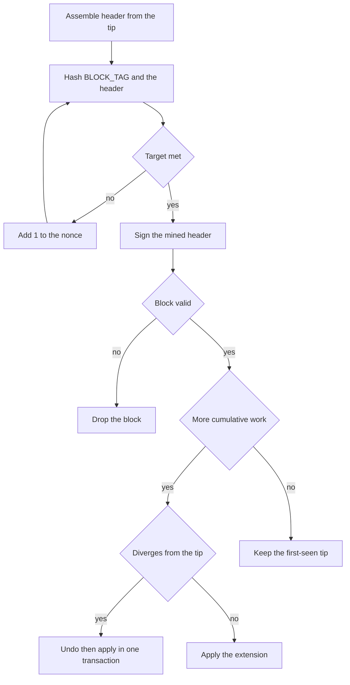

# ADR 0003: Consensus: proof of work

- **Status:** Accepted
- **Date:** 2026-10-29
- **Ticket:** [SCRUM-19](https://stevenkeith85.atlassian.net/browse/SCRUM-19)

## Status

Accepted.

## Context

LedgerLab is a single-node UTXO chain for a video series, and for reviewers who work in regulated finance. Sprint 1 runs one node. [ADR 0001](0001-canonical-serialisation.md) fixes the block header bytes, the block hash, and the detached Ed25519 proposer signature. [ADR 0002](0002-integer-amounts.md) fixes amounts. Those decisions leave open how a node produces a block and which valid chain is canonical.

The chain is a teaching system. It will not be a public network and it will not move real value. The rule still has to be exact: [SCRUM-16](https://stevenkeith85.atlassian.net/browse/SCRUM-16) will implement it, and a reviewer will check that the demo states its limits.

On one node, proof of work gives no real security and no Sybil resistance. It is the teaching mechanism for block production: a search, a target, and a tip that moves. The proposer signature from ADR 0001 is what attributes a block to a key.

Proof of authority is the better fit for a set of known, permissioned validators. LedgerLab has one operator and one process. This decision settles proof of work as the consensus mechanism. A different mechanism would be a new ADR.

[SCRUM-15](https://stevenkeith85.atlassian.net/browse/SCRUM-15) implements transactions. Transaction bytes and amount checks do not depend on how a header is mined.

## Options considered

### Proof of work (chosen)

Advantages: one node can produce blocks as soon as it can hash. The header from ADR 0001 already carries a proposer key and a signature, so each mined block is attributable to a key. Fork choice has a simple definition when every block on a chain carries the same difficulty. The demo can show a nonce, a hash, and a moving tip, which is the lesson sprint 1 is for. A fixed target needs no retarget algorithm.

Costs: the search spends CPU on purpose. On one node that work does not provide security or Sybil resistance, so the demo has to say so. Finality is probabilistic: a valid chain with more cumulative work replaces the tip. Viewers who treat the hash as a control will misunderstand the system.

### Proof of authority

Advantages: when the validators are known, authority is the better mechanism. Three named Ed25519 keys can take turns, and the cost is one signature rather than a search. A block is final once the scheduled signer's signature verifies, under a crash-fault assumption. The signer is accountable because the key is a member of a set the operator admitted. Identity is the admission control a permissioned, bank-style network already has. That is better than proof of work on energy, finality, accountability, and identity.

Costs: sprint 1 has a single process. Round-robin across one key is still a single signer. A validator set, a schedule, missed slots, and revocation are a protocol this series does not run. The chain is a teaching system and is not going into global use. Rejected.

If the network ever had multiple known, permissioned validators, proof of authority would be the better fit, for the reasons above. That would need a new ADR.

### Byzantine fault tolerance

Advantages: a quorum protocol can stay safe when some nodes are malicious. Four nodes is the usual minimum that tolerates one Byzantine fault. Finality is a quorum decision.

Costs: the series runs one node and is a teaching chain. There is no quorum to collect and no Byzantine participant to model. The view-change rules would be the largest piece of the node, and nothing in sprint 1 would exercise them. Rejected.

### Authoritative single writer

The node validates transactions and appends them. It does not mine, and it does not choose between two valid chains.

Advantages: the process that owns the database is the order. There is no target to choose and no fork to resolve.

Costs: ADR 0001 defines a block hash and a proposer signature, and nothing would then decide how a header is produced or which of two valid headers is canonical. The series would have no block-production demo. Rejected.

## Decision

Proof of work is the consensus mechanism for LedgerLab. Sprint 1 runs one node. Difficulty is fixed for a chain. The rules below apply to every block, including the genesis block.

### Header, hash, and target

[ADR 0001](0001-canonical-serialisation.md) is the authority for the header layout and for the target comparison. The header is the 128-byte version-1 header in that ADR. `difficulty_bits` (`u32`) and `nonce` (`u64`) sit at the end, in that order. The block hash is `SHA-256(BLOCK_TAG || header)`. Encoders use ADR 0001's unsigned big-endian rules for every integer in that header, then hash those bytes.

The target is the comparison ADR 0001 states. Read `block_hash` as a big-endian unsigned 256-bit integer `H`. The header meets the target only when `H < 2**(256 - difficulty_bits)`, with `difficulty_bits` in `0` through `255` inclusive. The inequality accepts every hash with at least `difficulty_bits` leading zero bits, and no hash with fewer. Implementations code that comparison. If this summary and ADR 0001 disagree, ADR 0001 wins.

### Difficulty

Difficulty is a chain-level consensus parameter: the `difficulty_bits` of the genesis block. ADR 0001 fixes that rule. Every later block on the chain must carry the same value. Every node that follows the chain is given that same genesis block. A node has no difficulty setting of its own. A header that names any other difficulty is invalid, so a locally edited genesis is a different chain.

There is no retarget. The genesis block's value is the required difficulty at every height. Difficulty retargeting is out of scope. A different target rule would be a new ADR.

| Chain | Genesis `difficulty_bits` | Expected attempts | Use |
| --- | --- | --- | --- |
| Demo | `20` | `2**20` (1,048,576) | Sprint 1 node |
| Test | `16` | `2**16` (65,536) | Fast deterministic tests |

The demo genesis block uses `20` so a block mines in about a second on a laptop. The mean search is 1,048,576 hashes of the ADR 0001 preimage. One CPython core hashing that preimage and writing a new nonce on each attempt runs at about one to two million hashes a second, so the mean wait is about a second on a modest laptop and a fraction of a second on a faster core. The wait is geometric: individual blocks scatter around that mean. `22` takes several seconds on a modest laptop, which is too slow for a live demo.

The test chain is a separate chain. Its genesis block uses `16`, the test-chain value ADR 0001's vectors pin (`block`, `block_boundary_pass`, `block_boundary_fail`). The mean search is 65,536 hashes, a few tens of milliseconds, so tests stay fast and still enforce a real target. The search starts at nonce `0`, so a fixed header template has one winning nonce. Consensus tests use this genesis. The demo genesis stays at `20`.

### Mining, then the proposer signature

Height `0` is the genesis block: `prev_block_hash` is 32 zero bytes, as ADR 0001 requires. Every later candidate uses height `tip + 1` and the tip's block hash as `prev_block_hash`. `tx_root`, `timestamp_ms`, and `proposer_public_key` are the ADR 0001 fields. `difficulty_bits` is the genesis value. The miner sets `timestamp_ms` from the UTC clock when it builds the candidate. A bound on clock drift is out of scope.

The search writes `nonce = 0` and adds one after each miss, re-encoding the header and hashing it again. The first nonce whose hash meets the target is the nonce of the block. The counter does not wrap. When the next nonce would not fit in a `u64`, the miner drops the candidate and builds a new header.

The proposer signs after the search, over that finished header, including `difficulty_bits` and the final `nonce`. The message is the ADR 0001 proposer signing preimage, `BLOCK_TAG || header`. The signature is the 64-byte Ed25519 signature carried beside the block. ADR 0001 keeps that signature out of the block hash. A signature over any other nonce fails verification. The node signs the header that met the target and then stops the search on that header.

Sprint 1 has one node and one proposer key. The signature must verify under the `proposer_public_key` in the header. Any key may be written there when the matching signature verifies. There is no allowlist and no round-robin schedule. The signature attributes the block to the holder of the key.

The private key comes from the process environment or a secret store. On GCP that store is Secret Manager. The key stays out of the repository.

A deterministic miner, including the test chain, fixes every header field except `nonce` before the search, then searches from `0`. The same template always yields the same nonce and the same block hash.

### Validation

A block is valid only when all of the following hold:

1. The header and the detached proposer signature decode under ADR 0001.
2. `difficulty_bits` equals the `difficulty_bits` of this chain's genesis block, and it lies in `0` through `255` inclusive, the range ADR 0001 allows.
3. `SHA-256(BLOCK_TAG || header)` meets the ADR 0001 target for that `difficulty_bits`.
4. The proposer signature verifies over `BLOCK_TAG || header` for this header, so the signature covers the final nonce.
5. At height `0`, `prev_block_hash` is 32 zero bytes. At any other height, `prev_block_hash` is the hash of a stored block whose height is one less.
6. The block's transactions are valid under ADR 0001 and ADR 0002, and `tx_root` is the commitment ADR 0001 defines over their ids in block order.

A block that fails any item is dropped. It is neither stored nor counted as work.

### Fork choice

The canonical chain is the valid chain with the most cumulative work. Ties are broken by first seen.

```text
work(block) = 2 ** difficulty_bits
cumulative_work(chain) = sum of work(block) from genesis through the tip
```

The sum includes the genesis block. It is an integer sum, computed with arbitrary-precision integers (Python `int`) from the difficulty of each valid block. With the fixed genesis difficulty `D`, every valid block has `work = 2**D`, so `cumulative_work = block_count * 2**D`. The chain with the most work is the longest chain. Implementations compare the integer sums.

The node stores one canonical tip. It adopts a candidate only when that chain is valid and its cumulative work is strictly greater than the stored tip's. The empty chain has cumulative work `0`, so a valid genesis replaces it. Equal cumulative work leaves the stored tip in place: the chain the node already adopted stays canonical. Hash, timestamp, and nonce do not break the tie.

Only a valid block contributes work. A header whose `difficulty_bits` differs from genesis fails validation, so advertising a harder target cannot raise the sum.

### Reorgs

Sprint 1 has one node and one miner, so a competing chain does not arise in ordinary operation. The design must still support a reorg. A heavier valid chain replaces the tip, including in tests and including when a node loads an alternative chain.

[SCRUM-20](https://stevenkeith85.atlassian.net/browse/SCRUM-20) stores undo data for every applied block. The record restores spent outputs and removes created outputs.

Adopting a chain that diverges from the current tip is one Postgres transaction, implemented in [SCRUM-20](https://stevenkeith85.atlassian.net/browse/SCRUM-20):

1. Walk from the current tip back to the common ancestor. For each block, apply its undo: restore the spent outputs, remove the created outputs.
2. Apply the candidate blocks from the child of that ancestor through the new tip, and store undo data for each new block.
3. Commit. If any step fails, the database transaction rolls back and the previous tip stays canonical.

A candidate that only extends the current tip has an empty undo walk. The node applies the new block or blocks in one Postgres transaction ([SCRUM-20](https://stevenkeith85.atlassian.net/browse/SCRUM-20)).

### Block production and validation



## Consequences

- **Header layout.** The header amendment is in scope for this decision and lands on [PR #1](https://github.com/stevenkeith85-1/ledger-lab/pull/1), with ADR 0001 and [docs/adr/vectors/](vectors/). It is part of that change, already on the branch this ADR stacks on. It is not a follow-up. This ADR does not edit ADR 0001 or the vectors. The 128-byte header, the target inequality, and the test-chain difficulty of `16` are taken from ADR 0001.
- **Blocks.** [SCRUM-16](https://stevenkeith85.atlassian.net/browse/SCRUM-16) implements the mining loop, the genesis difficulty check, and fork choice. [SCRUM-20](https://stevenkeith85.atlassian.net/browse/SCRUM-20) implements persistence of `difficulty_bits` and `nonce`, per-block undo data, and the reorg transaction.
- **Transactions.** [SCRUM-15](https://stevenkeith85.atlassian.net/browse/SCRUM-15) is unchanged. Bodies, ids, signatures, and amount limits stay on ADR 0001 and ADR 0002.
- **Finality.** Proof of work is probabilistic. The tip stays canonical until a valid chain with greater cumulative work replaces it. The sprint 1 demo has one miner, so the tip the node just produced stays in place in practice. The rule still treats the tip as replaceable.
- **One node.** The sprint 1 process is a single point of failure. That limit is accepted for the demo. Reorg support keeps the UTXO set on the canonical chain. It does not add a second node.
- **Tests.** Consensus tests use the test genesis (`difficulty_bits` `16`) and a fixed header template, searching from nonce `0`. They check a mined hash against the ADR 0001 target, a proposer signature over that mined header, adoption of a heavier chain, an equal-work chain leaving the tip in place, and a rollback that restores spent outputs and removes created outputs. The serialisation vectors already pin that difficulty, including a hash that passes with exactly 16 leading zero bits and a hash that fails with 15.
- **Out of scope.** Difficulty retargeting, a validator set, round-robin scheduling, proof of authority, and Byzantine consensus. Any of those, if the premise changes, is a new ADR.
- **Coinbase and empty blocks.** These stay the open points in ADR 0001. SCRUM-16 decides them. Mining does not change their encoding.

### Non-functional

- **Security.** Proof of work on one node is a teaching mechanism. It is not a security control. The proposer signature is what attributes a block to a key. The private key is never written to the repository or to logs.
- **Auditability.** Every block carries `proposer_public_key` and a signature over the mined header, so a reviewer can attribute the block from the bytes alone. Validation is a deterministic function of the block bytes, the genesis difficulty, and ADR 0001. The header version remains the version ADR 0001 specifies. Demo and test publish difficulty in genesis, so the target can be recomputed without asking the node.
- **Resilience.** Sprint 1 accepts a single point of failure. Undo data lets the UTXO set follow fork choice inside one Postgres transaction: spent outputs are restored, created outputs are removed, and a failed transaction leaves the previous tip in place.
- **Observability.** When a block is mined, the node logs the block hash, the nonce, the attempt count, and the mining time. It does not log the proposer private key or the seed.

### Open points

- **`AGENTS.md`.** [SCRUM-13](https://stevenkeith85.atlassian.net/browse/SCRUM-13) owns that file. It is not on this branch. When it lands, it should link to this ADR and should not copy these rules.
